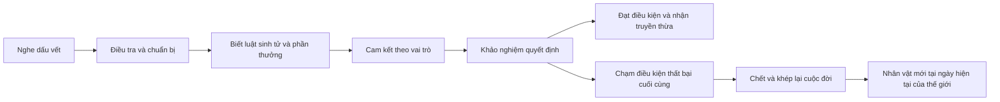

# Thiết kế game Cổ Tiên Lộ trong thế giới Cổ Chân Nhân

Ngày biên soạn 23 tháng 10 năm 2026. Bản thiết kế 1.

Cổ Tiên Lộ là game nhập vai nhiều người trong một thế giới chung có lịch sử liên tục. Người chơi trải qua nhiều cuộc đời, dùng kiến thức đã học để lựa chọn hành trình mới, trong khi cơ duyên, tài nguyên và quan hệ trong thế giới tiếp tục thay đổi. Trọng tâm là sống một cuộc đời Cổ Sư có ý nghĩa, từ việc kiếm thức ăn cho một con Cổ đến việc quyết định có nên đánh cược sinh mạng trước cửa truyền thừa.

Người dùng đã chọn mô hình nhiều người tranh đoạt trong cùng máy chủ. Các con số về quy mô, thời lượng và cân bằng dưới đây là đề xuất thiết kế cần thử nghiệm. Đây là tài liệu thiết kế, chưa phải các chức năng đã được triển khai trong bản chơi hiện tại.

Tệp yêu cầu nhận được kết thúc giữa câu ở mục 4, sau “không tự biến thành năng lực của”. Tài liệu bao quát toàn bộ phần đã nhận và bổ sung cơ chế cho sáu ưu tiên được nêu rõ: thế giới rộng, truyền thừa ẩn, khảo nghiệm sinh tử, Tiên Cổ duy nhất, Nhân Tổ Truyện thành trải nghiệm tương tác và sức mạnh hình thành từ cách chơi.

## Quy ước về nguyên tác và chuyển thể

- **[NT]** là thiết lập nguyên tác đã được đối chiếu trong văn bản chương được dẫn nguồn. Nguồn xác minh một quy tắc không đồng nghĩa xác minh toàn bộ diễn biến lịch sử quanh nó.
- **[TK]** là thiết kế bổ sung cho game. Toàn bộ luật máy chủ, chỉ số, nhiệm vụ, địa danh mới, NPC mới, truyền thừa mẫu và phần thưởng mới trong tài liệu thuộc nhóm này, trừ khi được ghi [NT].
- **[CX]** là chi tiết chưa xác minh đủ. Nội dung này không được dùng làm dữ kiện chắc chắn để dựng trạng thái ban đầu của máy chủ.

Tên **Cổ Tiên Lộ** được giữ theo dự án. Những tên địa phương trong các bảng thiết kế là tên làm việc do tài liệu đặt ra; không khẳng định chúng có trong truyện hoặc chưa từng trùng với một bản dịch khác.

## Nghiên cứu nguyên tác và giới hạn xác minh

Đã đọc và đối chiếu văn bản tại 17 chương trong bảng dưới, với phạm vi ghi riêng cho từng nhóm. **Chưa đọc toàn bộ Cổ Chân Nhân**, chưa đối chiếu nguyên bản Trung văn và chưa kiểm kê đầy đủ nhân vật, thế lực, Tiên Cổ ở thời điểm mở truyện. Các bản tiếng Anh được dùng khi trang tiếng Việt bị che nội dung. Số chương giữa các nền tảng có thể lệch; phải nhận diện thêm bằng tên chương và sự kiện.

| Văn bản đã đọc | Phạm vi và dữ kiện dùng trong thiết kế |
| --- | --- |
| [Chương 1](https://truyendich.space/doc-truyen/co-chan-nhan/chuong-1) và [chương 4](https://truyendich.space/doc-truyen/co-chan-nhan/chuong-4) | Đọc phần truyện hiển thị chương 1 và đoạn đầu chương 4. Xác định Thanh Mao Sơn, Cổ Nguyệt sơn trại, Nam Cương và thời điểm trước Khai Khiếu Đại Điển. |
| [Chương 5](https://truyendich.space/doc-truyen/co-chan-nhan/chuong-5) và [chương 6](https://truyendich.space/doc-truyen/co-chan-nhan/chuong-6) | Đọc phần truyện hiển thị. Nhân Tổ, Sức Mạnh, Trí Tuệ, Hi Vọng và Khốn Cảnh; khai khiếu, nguyên hải và chân nguyên. |
| [Chương 7 bản Anh](https://novelfull.com/reverend-insanity/chapter-7.html) và [chương 10 bản Anh](https://novelfull.com/reverend-insanity/chapter-10.html) | Đọc văn bản thay thế. Cửu chuyển, tư chất và quá trình luyện hóa Cổ có ý chí. Không lấy lời giảng sơ cấp để áp dụng máy móc cho mọi cảnh giới hậu kỳ. |
| [Chương 19](https://truyendich.space/doc-truyen/co-chan-nhan/chuong-19) và [chương 23](https://truyendich.space/doc-truyen/co-chan-nhan/chuong-23) | Đọc phần truyện hiển thị. Xuân Thu Thiền lục chuyển bản mệnh của Phương Nguyên; nuôi, luyện, dùng Cổ và gánh nặng nuôi dưỡng. |
| [Chương 38 bản Anh](https://roliascan.com/read/reverend-insanity/ch38-97383/) | Đọc đoạn kể Nhân Tổ trong văn bản chương. Hai Cổ có dạng cầu và lập phương; biết tên là điều kiện sai khiến. Tạm giữ tên Anh Rules và Regulations để tránh chốt sai cách Việt hóa. |
| [Chương 335 bản Anh](https://likesnovel.com/read/reverend-insanity/335) | Đọc đoạn về tổ chức. Phân biệt hệ thống môn phái Trung Châu với gia tộc Nam Cương; xác nhận vị trí của Tiên Hạc Môn trong mười đại phái. Không đưa trạng thái nhân vật ở chương này về ngày mở truyện. |
| [Chương 609 bản Anh](https://bookme.win/book/reverend-insanity-2/chapter-609) | Đọc văn bản hiển thị. Thăng tiên, tiên khiếu như thế giới nhỏ; tiên khiếu lục và thất chuyển là phúc địa, bát và cửu chuyển là động thiên. |
| [Chương 674 bản Anh](https://www.pyg-kit.com/en/books/reverend-insanity/chapters/78628) | Đọc đoạn địa lý và kinh tế đầu chương. Tây Mạc, sa mạc, ốc đảo và quan hệ kiểm soát tài nguyên. |
| [Chương 928 bản Anh](https://bookme.win/book/reverend-insanity-2/chapter-928) | Đọc đoạn đầu đến phần vượt giới. Địa hình Đông Hải, Bắc Nguyên; giới bích cản sinh mệnh mạnh hơn nghiêm trọng hơn. |
| [Chương 1043 trên Webnovel](https://www.webnovel.com/book/reverend-insanity_7996858406002505/surprising-discovery_38262646369210534) | Chỉ đọc đoạn mở đầu công khai. Xác minh có năm giới bích; Ngũ Vực Sơn Mạch mô phỏng giới bích, không phải chính ranh giới Ngũ Vực. |
| [Chương 1212 bản Anh](https://novelfull.com/reverend-insanity/chapter-1212-burning-soul-bursting-luck.html) | Đọc đoạn giải thích việc luyện Định Tiên Du thất bại vì đã có cá thể tồn tại. Đây là chứng cứ trực tiếp cho quy tắc Tiên Cổ duy nhất. |
| [Chương 1241 trên Webnovel](https://www.webnovel.com/book/reverend-insanity_7996858406002505/journey-in-black-heaven_40585311532666468) | Chỉ đọc đoạn mở đầu công khai. Cửu thiên thuộc lịch sử; ở thời kỳ này chỉ Hắc thiên và Bạch thiên còn nguyên, đường lên có thiên phong khí tường. |
| [Chương 1285 bản Anh](https://novelkeep.com/novel/reverend-insanity/chapter-1285-fang-yuans-perseverance/) | Đọc đoạn chính về Nghịch Lưu Hà và sự hình thành Perseverance Immortal Gu. Đây là diễn biến tuyến chính có nhắc Nhân Tổ Truyện, không phải một tích Nhân Tổ hoàn chỉnh được đọc riêng. |

Các trang chương 7, 10, 14, 15, 29, 38 và 39 trên nguồn người dùng đưa đã có lần trả nội dung che hoặc mã hóa; việc mở được tiêu đề không được tính là đọc nội dung. Một số trang chương muộn không truy cập được. Không dùng tóm tắt wiki làm chứng cứ cho các nhãn [NT].

**[CX] Cần kiểm chứng thêm trước khi sản xuất nội dung nguyên tác:** danh sách đại thế lực từng vực ở đúng ngày mở truyện; trạng thái từng phúc địa nổi tiếng; chủ sở hữu và cấp của từng Tiên Cổ; cách Việt hóa thống nhất của Rules, Regulations, Perseverance và năm giới bích; các tích Nhân Tổ chưa có trong tập nguồn. Vì vậy, phần chi tiết địa phương sử dụng thế lực và truyền thừa [TK], thay vì gán lịch sử mới cho tên nguyên tác.

## Bối cảnh và lời hứa trải nghiệm

### Mốc khởi đầu

**[TK] Ngày đầu máy chủ đặt ngay trước Khai Khiếu Đại Điển đầu truyện, sau khi Phương Nguyên trở về tuổi thiếu niên.** Địa lý nền dùng trạng thái thời kỳ này. Các giải thích về cấu trúc thế giới ở chương muộn chỉ bổ sung kiến thức nền, không mang quyền sở hữu hoặc liên minh hậu kỳ về quá khứ.

Lựa chọn này cho phép bắt đầu từ sinh hoạt Cổ Sư cấp thấp, giữ rào cản đi lại giữa các vực và dành không gian cho nhiều thế hệ người chơi. Ngày khởi đầu có thể kể lại nhất quán; mọi biến động sau đó thuộc **nhánh lịch sử của máy chủ [TK]**.

Các ràng buộc niên đại:

- Ngũ Vực còn ngăn cách. Việc đi từ vực này sang vực khác phải xử lý cả địa hình lẫn giới bích liên quan.
- Tầng trời nguyên vẹn là Hắc thiên và Bạch thiên. Các màu trời khác chỉ xuất hiện dưới dạng lịch sử, mảnh vỡ hoặc không gian đặc biệt đã được xác minh hay ghi [TK].
- Không mở đầu bằng danh hiệu, liên minh hoặc cục diện tôn giả hậu kỳ của Phương Nguyên. Nhân vật này chưa đóng vai người thống trị hậu kỳ trong trạng thái ban đầu.
- Không hẹn lịch bắt buộc Thanh Mao Sơn bị hủy hoặc Túc Mệnh Cổ bị phá. Một biến cố lớn chỉ diễn ra nếu các điều kiện thực tế của nhánh máy chủ dẫn tới nó.
- Xuân Thu Thiền không trở thành nút tải lại chung của người chơi. Việc khóa tính năng đảo ngược lịch sử máy chủ là giới hạn chuyển thể [TK], không phải tuyên bố nguyên tác không có trùng sinh.

Nhân vật nguyên tác là tác nhân trong thế giới, có mục tiêu và nguồn lực. Họ không tự động nhận mọi cơ duyên đúng lịch truyện, không xuất hiện để giải cứu người chơi thất bại và không phải các bản sao riêng cho từng tài khoản. Những nhân vật nổi tiếng chưa hoàn tất hồ sơ niên đại sẽ chưa được đưa vào nội dung có thể tương tác trực tiếp.

### Thế lực và các lớp biến động

**[NT] Phạm vi thế lực đã đối chiếu:** Cổ Nguyệt, Bạch gia và Hùng gia thuộc bối cảnh Thanh Mao Sơn ở phần mở đầu; Tiên Hạc Môn thuộc hệ thống mười đại phái Trung Châu được mô tả ở chương muộn. Việc biết một tổ chức tồn tại không xác minh được người đứng đầu, quân số và toàn bộ tài sản của nó tại ngày mở máy chủ. [Nguồn chương 1](https://truyendich.space/doc-truyen/co-chan-nhan/chuong-1), [chương 335](https://likesnovel.com/read/reverend-insanity/335).

| Lớp biến động | Cách dùng trong bối cảnh |
| --- | --- |
| Lịch sử trước mốc mở truyện | Cửu thiên không còn nguyên vẹn; dùng dấu tích và tư liệu để khám phá lịch sử, không trình bày như biến cố mới vừa xảy ra trong máy chủ. |
| Trạng thái tại ngày đầu | Ngũ Vực còn bị chia cắt; xã hội địa phương, nguồn nguyên thạch và quyền tiếp cận tri thức định hình cơ hội của người mới. |
| Diễn biến biết qua chương muộn | Cạnh tranh truyền thừa, thăng tiên, thay đổi quyền giữ Tiên Cổ cho biết loại sự kiện thế giới có thể có; kết quả riêng của những chương đó không được coi là đã xảy ra ở ngày đầu. |
| Lịch sử mới sau khi mở máy chủ [TK] | Dịch bệnh, đổi tuyến thương mại, khôi phục di tích, chuyển quyền lãnh thổ và liên minh được kích hoạt bởi tài nguyên, quan hệ và hành động thực tế; có dấu hiệu báo trước và có hậu quả lâu dài. |

Để năm vực có chính trị địa phương ngay trong thiết kế mẫu, sử dụng năm tổ chức mới dưới đây. **Mọi tên tổ chức và NPC trong bảng đều là [TK]**, không thay thế hay được gán vị trí đại thế lực nguyên tác. Thành viên cũng có lợi ích riêng, nên quan hệ với một người không đồng nghĩa được cả tổ chức tin cậy.

| Tổ chức địa phương [TK] | Địa bàn và nguồn lực | Mục tiêu và mâu thuẫn | NPC đầu mối [TK] |
| --- | --- | --- | --- |
| Hội Tam Bến | Nam Cương; bè hàng, kho trúc và người dẫn đường | Muốn nối ba bến nhưng hai trại muốn giữ phí độc quyền; cần người cứu nguồn thức ăn bị bệnh | Lâm Đạc, người điều phối hàng biết một phần bí mật buồng dưỡng |
| Đoàn Bạch Hành | Bắc Nguyên; xe tải, kho lương và trạm trú | Cần giữ hành lang cỏ qua mùa bão; người bảo vệ muốn giết đàn thú, người dẫn đàn muốn chuyển chúng | Mộc Tư, người giữ sổ hành trang đang tìm đoàn mất tích |
| Thủy Lộ Hội | Đông Hải; hoa tiêu, bến và lịch triều | Muốn bảo vệ tuyến an toàn nhưng nội bộ tranh quyền bán thông tin; sợ tuyến mới phá thu nhập cũ | Kha Viễn, hoa tiêu có lời chứng trái hải đồ chính thức |
| Minh Ước Song Tỉnh | Tây Mạc; quyền mở giếng và điều phối nước | Muốn duy trì hai cộng đồng nhưng tranh cách chia nước trong mùa khô; khai thác thêm có thể làm sụp hồ ngầm | Sa Định, người đo mực nước giữ bản ghi bị sửa |
| Tĩnh Văn Môn | Trung Châu; thư khố nhỏ, thầy dạy và mạng người chép khế | Muốn phục hồi tri thức, đồng thời lo tài liệu cũ làm mất uy tín một người bảo trợ | Tống Nhược, người sao sách cần vật liệu phục dựng từ Nam Cương |

Quan hệ giữa các tổ chức tạo hành trình liên vực: Hội Tam Bến cung ứng vật liệu cho Tĩnh Văn Môn; Thủy Lộ Hội vận chuyển giấy và dụng cụ tới Tây Mạc; Đoàn Bạch Hành cần muối và chất bảo quản. Khi một nguồn hàng bị cắt, giá, việc làm và liên minh thay đổi theo, tạo lý do đi xa ngoài việc tăng cảnh giới.

### Ba phương án tổ chức thế giới

| Phương án | Đánh đổi |
| --- | --- |
| Thế giới riêng có lịch sử liên tục | Dễ bảo đảm nhịp trải nghiệm cá nhân và chơi offline; tranh đoạt giữa người thật không phải trọng tâm. |
| **Thế giới chung liên tục đã được người dùng chọn** | Cơ duyên và chính trị có giá trị xã hội; cần xử lý độc quyền, người mới, mất kết nối và vận hành máy chủ. |
| Thế giới riêng kết hợp máy chủ chung | Linh hoạt hơn nhưng phải tách kinh tế và vật phẩm; nếu cho chuyển tài sản tự do sẽ phá tính duy nhất. |

Tài liệu triển khai phương án thứ hai. Một máy chủ thế giới có thể chạy trên nhiều tiến trình kỹ thuật nhưng chỉ có một lịch sử, một nền kinh tế và một sổ Tiên Cổ. Không tự chia bản sao khu vực để sinh thêm cùng một Tiên Cổ.

### Vòng chơi của một cuộc đời

Xuất thân tạo ra cơ hội ban đầu. Người chơi kiếm sống, nuôi Cổ và xây quan hệ; từ đó có điều kiện đi xa, thu thập manh mối, tìm truyền thừa và quyết định có cam kết khảo nghiệm sinh tử hay không. Người sống sót mang kiến thức, tài sản và danh tiếng mới trở lại xã hội. Người chết để lại di vật, lời đồn, kẻ thù hoặc món nợ cho thế giới.

Một phiên ngắn vẫn có thể hoàn thành việc chăm Cổ, điều tra một lời đồn hoặc chuẩn bị hành trang. Một chuyến thám hiểm dài cần đủ thời gian quay về hay đến nơi trú hợp lệ. Game không buộc mọi phiên phải vào khảo nghiệm sinh tử mới có tiến triển.

## Hệ thống tu luyện và sức mạnh hình thành từ cách chơi

### Khung tu luyện

**[NT]** Không khiếu chứa nguyên hải; chân nguyên dùng để thúc đẩy Cổ. Tư chất ảnh hưởng điều kiện tu luyện ban đầu. Luyện hóa, nuôi dưỡng và vận dụng Cổ là các công việc khác nhau. Cổ cần thức ăn phù hợp, nên sở hữu nhiều không đồng nghĩa sử dụng được nhiều. [Nguồn chương 6](https://truyendich.space/doc-truyen/co-chan-nhan/chuong-6), [chương 10](https://novelfull.com/reverend-insanity/chapter-10.html), [chương 23](https://truyendich.space/doc-truyen/co-chan-nhan/chuong-23).

**[TK]** Lộ trình game chia thành giai đoạn Cổ Sư nhất đến ngũ chuyển và Cổ Tiên từ lục chuyển. Bốn mức sơ, trung, cao, đỉnh phong được áp dụng cho giai đoạn phàm đã thiết kế; không kéo thanh kinh nghiệm bốn mức ấy sang mọi chuyển hậu kỳ. Thăng tiên là một hệ thống chuẩn bị và khảo nghiệm riêng, lấy cảm hứng từ sự tích lũy và rủi ro trong [chương 609](https://bookme.win/book/reverend-insanity-2/chapter-609).

Mỗi nhân vật có năm nhóm điều kiện phát triển: nền tảng thân thể và không khiếu; tài nguyên; hiểu biết có thể áp dụng; bộ Cổ phù hợp; quan hệ giúp tiếp cận kiến thức và địa điểm. Không có điểm “chiến lực tổng” được dùng để quyết định thắng mọi tình huống.

### Nuôi Cổ tạo ra hành trình

**[NT]** Nguyệt Quang Cổ ăn cánh hoa nguyệt lan, Tửu Trùng uống rượu. Chi tiết này cho thấy hậu cần có thể quyết định hướng sống của Cổ Sư. [Nguồn chương 23](https://truyendich.space/doc-truyen/co-chan-nhan/chuong-23).

**[TK]** Mỗi Cổ trong game có khẩu phần, chu kỳ ăn, điều kiện bảo quản và lựa chọn thức ăn thay thế được ghi rõ sau khi nghiên cứu. Thiếu một bữa tạo suy yếu có cảnh báo; thiếu kéo dài mới dẫn tới chết Cổ. Người chơi có thể trồng, mua, thuê cung ứng, di cư hoặc đổi bộ Cổ để thích nghi. Nguồn thức ăn đặc biệt trong các vùng mẫu dưới đây là tài nguyên sáng tạo.

Nuôi Cổ khi vắng mặt được xử lý bằng kho và hợp đồng cung ứng. Giao diện cho biết số ngày thực còn được bảo đảm. Kho không tự sinh thức ăn; nguồn cung có thể cạn. Game ưu tiên chu kỳ đủ dài để người chơi sinh hoạt bình thường, không dùng việc phải đăng nhập mỗi vài giờ làm thước đo tu luyện.

### Luyện Cổ và dùng Cổ

**[TK]** Phân biệt luyện hóa một cá thể để sử dụng với hợp luyện tạo hoặc nâng cấp Cổ. Công thức ghi nguyên liệu, điều kiện môi trường, thao tác và các phần chưa hiểu. Sai nguyên liệu, kiểm soát nhiệt kém và công thức thiếu tạo những rủi ro khác nhau. Độ bất định phải xuất phát từ thông tin hoặc quá trình cụ thể; không hiện tỷ lệ giả như thể người chơi biết hết mọi biến số.

Trong phòng luyện thông thường, thất bại có thể mất vật liệu hoặc gây thương tích. Chỉ một quy trình đã được giới thiệu là sinh tử, hoặc tình trạng tổn thương thực sự chí mạng, mới kết thúc đời. Không đồng nhất mọi lần luyện thất bại với quy tắc chết của khảo nghiệm truyền thừa quyết định.

Khi dùng Cổ, người chơi giải quyết bài toán về chân nguyên, tầm hoạt động, thời điểm, địa hình, phối hợp và dấu hiệu bị đối phương đọc ra. Bộ Cổ mạnh nhưng không đủ thức ăn hay không có đường rút có thể là lựa chọn kém cho chuyến đi dài.

### Học nghề và hình thành tổ hợp

**[TK]** Không khóa lớp nhân vật ngay khi tạo tài khoản. Hệ thống ghi năng lực đã chứng minh trong đời hiện tại: nhận biết bệnh Cổ, điều tra dấu vết, điều khiển đàn, giữ nhịp luyện, dựng trận, sử dụng địa hình, thương lượng và truyền đạt kiến thức. Luyện lặp một thao tác không nguy hiểm có mức lợi ích giảm dần; muốn tiến xa phải xử lý tình huống mới.

| Cách sống | Năng lực hình thành | Lợi thế thực tế | Giới hạn cần giải quyết |
| --- | --- | --- | --- |
| Chuyên cứu chữa Cổ bệnh | Chẩn đoán, khẩu phần, kiểm soát tổn thương | Nuôi bộ Cổ khó chăm; cứu tài sản của đồng đội | Khả năng kết liễu thấp, lệ thuộc dược liệu |
| Dẫn đoàn qua nhiều vùng | Đọc đường, thời tiết, bố trí tiếp tế | Đi sâu với chi phí thấp; bán dịch vụ dẫn đường | Tuyến quen có thể đổi chủ hoặc bị phong tỏa |
| Nghiên cứu và hợp luyện | Phân tích công thức, kiểm soát quy trình | Tạo bộ Cổ phù hợp mục tiêu, bán chuyên môn | Cần vốn, nguyên liệu và nơi luyện an toàn |
| Chuyên đấu ở địa hình hẹp | Nhịp công thủ, bố trí bẫy, ép vị trí | Dùng Cổ phổ thông hiệu quả trong phạm vi quen | Bất lợi trên đồng trống hoặc khi bị cắt tiếp tế |
| Giao dịch thông tin | Kiểm chứng, giữ bí mật, định giá lời hứa | Tiếp cận cửa vào và liên minh khó mua bằng tiền | Tin cũ và uy tín bị mất có thể làm đổ mạng lưới |

Ví dụ hai người cùng có Cổ tấn công tầm xa: người trinh sát biết chọn sườn núi và giữ đường thoát, người điều khiển đàn tạo góc ép để bắn, người chuyên luyện điều chỉnh bộ hỗ trợ để tiết kiệm chân nguyên. Những tổ hợp ví dụ này là [TK], không phải sát chiêu được gán cho nguyên tác.

Ba cấu hình minh họa dưới đây dùng **các Cổ sáng tạo [TK]**. Chúng cho thấy quan hệ giữa năng lực và thói quen chơi; không phải danh sách Cổ được xác minh từ truyện.

| Cấu hình [TK] | Công cụ và cách vận dụng | Điều kiện thắng và cách đối phó |
| --- | --- | --- |
| Người săn đường hẹp | Cổ Dò Chấn nhận rung mặt đất, Cổ Kết Tơ tạo vật cản và một Cổ công kích phổ thông; học đọc hướng tới rồi ép mục tiêu vào góc đã chuẩn bị | Có lợi thế khi kịp bố trí trên nền truyền rung; đối thủ đi trên mặt mềm, phá tơ từ xa hoặc kéo ra đồng trống làm kế hoạch kém hiệu quả |
| Người dưỡng Cổ đường dài | Cổ Phân Dưỡng giúp chia khẩu phần và Cổ Lọc Sương tạo nguồn nước hỗ trợ, kết hợp chuyên môn chăm Cổ; không thay thế toàn bộ thức ăn đặc thù | Vượt tuyến dài và hỗ trợ nhóm tốt hơn, đổi lại tiêu hao tải trọng và thời gian chăm; môi trường thiếu sương hoặc mất vật liệu lọc buộc đổi hành trình |
| Người đọc dòng nước | Cổ Cảm Lưu nhận biến đổi dòng chảy và Cổ Ký Bọt lưu dấu quan sát ngắn; dùng kiến thức để chọn đường, bố trí đòn và kiểm tra lời khai | Mạnh gần mặt nước có dòng rõ; dòng nhiễu, môi trường khô hoặc tín hiệu giả cần cách kiểm chứng khác, không được biến thành năng lực biết mọi thứ |

Không cấu hình nào tự cộng cảnh giới do người chơi chọn một nhãn nghề. Người đổi cách sống vẫn có thể học hướng mới, nhưng phải chịu thời gian, tài nguyên và chi phí duy trì bộ công cụ khác.

Đọc công thức trong nhật ký tài khoản không cấp thành tựu nghề cho thân thể mới. Người chơi được thử sớm nhờ biết mình cần học gì, nhưng vẫn phải có Cổ, vật liệu, thao tác và điều kiện tu luyện tương ứng.

## Bản đồ Ngũ Vực và các lớp khám phá

### Quy mô nội dung

**[TK] Mục tiêu dài hạn:** 5 đại vực, mỗi vực 12 khu địa lý lớn, mỗi khu khoảng 6 tiểu vùng, tổng khoảng 360 tiểu vùng. Mỗi tiểu vùng có tối thiểu 8 điểm có chức năng, tạo khoảng 2.880 điểm nội dung nền. Không quy đổi con số này thành diện tích thật của nguyên tác hoặc cam kết đã có từng ấy nội dung.

Một tiểu vùng đạt yêu cầu khi có hệ sinh thái riêng, ít nhất một quan hệ xã hội đáng nhớ, một vấn đề đang diễn ra, hai hướng giải quyết khác nhau, một bí mật có bằng chứng và một lý do quay lại sau khi mạnh hoặc hiểu biết hơn. Biến thể màu đất và quái vật không được tính là tiểu vùng mới có ý nghĩa.

Thế giới gồm các vùng chơi trực tiếp nối với mạng hành trình đường dài. Di chuyển giữa những nơi xa có các chặng với sự kiện, tiếp tế và quyết định; chỉ tải cảnh chi tiết khi có tương tác cần thiết. Nhờ vậy bản đồ có thể rộng mà không yêu cầu hàng giờ chạy trên nền đất trống.

### Khung địa lý nguyên tác

**[NT]** Nam Cương gắn với núi rừng và các gia tộc; Trung Châu có hệ thống môn phái. Đông Hải có những vùng biển khác nhau, Bắc Nguyên có nhiều thảo nguyên, đồng bằng và gò; Tây Mạc có sa mạc và các ốc đảo sinh sống. Các nét nền này được đối chiếu ở [chương 4](https://truyendich.space/doc-truyen/co-chan-nhan/chuong-4), [335](https://likesnovel.com/read/reverend-insanity/335), [674](https://www.pyg-kit.com/en/books/reverend-insanity/chapters/78628) và [928](https://bookme.win/book/reverend-insanity-2/chapter-928).

Các bảng tiếp theo là **30 tiểu vùng mẫu [TK]**, sáu vùng cho mỗi đại vực. Mọi tên địa phương, cộng đồng địa phương, tài nguyên đặc biệt và bí mật trong các bảng này đều là sáng tạo cho game. Các đại thế lực nguyên tác không được coi là đã hoàn tất kiểm chứng chỉ vì một tiểu vùng nằm trong địa bàn tương ứng.

### Nam Cương

| Tiểu vùng | Cộng đồng và đường đi | Tài nguyên và sinh thái | Bí mật và lý do quay lại |
| --- | --- | --- | --- |
| Thung Dưỡng Trúc | Ba trại trồng trúc đổi hàng qua cầu dây | Nấm sống dưới gốc trúc bệnh; mùa mưa đổi loại nấm | Bệnh trúc là dấu vết một phòng dưỡng Cổ; quay lại khi biết chẩn bệnh để cứu nguồn thu cả thung |
| Hẻm Ba Vết | Thợ săn và đội thu phí chia hai lối đèo | Thú săn theo tiếng vọng, đá giữ âm | Vết cào trên cao chỉ ra lối vòng sau ổ thú; khi có khả năng leo có thể mở đường hộ tống |
| Chợ Mưa Đen | Người gùi hàng, chủ trọ và môi giới hoạt động theo mùa | Dược liệu ưa mưa, rượu địa phương | Một đơn mua hàng lặp sai số là mật thư; quay lại khi biết người nhận ở Trung Châu |
| Ruộng Đá Ong | Nông hộ và người nuôi ong tranh nguồn nước | Hoa mọc trong khe đá, mật nhiều cấp chất lượng | Tập tính ong dẫn vào giếng cũ; giải quyết nước sẽ thay đổi giá thực phẩm vùng lân cận |
| Hang Đèn Tắt | Thợ mỏ đi theo các giếng thông khí | Khoáng phát quang chỉ sáng khi thiếu một chất khí | Lối tưởng là ngõ cụt là cửa luyện thất; quay lại với dụng cụ đo khí thay vì sức chiến đấu |
| Bến Rễ Treo | Dân bè và hai trại đối đầu kiểm soát đường sông | Cá ăn rễ ngập, gỗ nổi bền | Bia chìm xuất hiện khi nước rút; xây lại bến mở tuyến trở về nhanh nhưng phải thỏa thuận quyền thu phí |

### Bắc Nguyên

| Tiểu vùng | Cộng đồng và đường đi | Tài nguyên và sinh thái | Bí mật và lý do quay lại |
| Đồng Cỏ Gãy | Các nhóm chăn thả chuyển trại theo nguồn nước | Cỏ mọc thành dải chỉ hướng thú di cư | Những khoảng cỏ bị tránh tạo bản đồ đường cũ; quay lại mùa khác thấy cả tuyến đổi hướng |
| Bãi Chuông Xương | Đoàn xe và người giữ mộ chung một giếng | Xương thú cộng hưởng với gió | Tiếng chuông chỉ đường qua bão; kẻ bán chuông biết một nửa thông tin và cần người kiểm chứng |
| Hồ Tan Muộn | Ngư dân và trại trú đông có lợi ích trái nhau | Cá dưới băng, địa y chịu lạnh | Vệt tan sớm báo một kho nhiệt dưới đáy; quay lại khi có hậu cần lặn để cứu nghề cá hoặc khai thác kho |
| Vành Sói Đêm | Người dẫn đàn và đội bảo vệ tranh hành lang cỏ | Đàn sói đổi lãnh địa theo mùi | Có thể chuyển đàn sang lối an toàn thay vì giết sạch; kết quả quyết định tuyến thương mại mùa sau |
| Đồi Cờ Rách | Hậu duệ hai nhóm chiến bại trao đổi tại hội chợ | Sợi vải cũ và đất chứa kim loại | Cờ là mảnh sơ đồ tiếp tế; quay lại với lời chứng ở Đông Hải để chứng minh một vụ phản bội |
| Trạm Hành Nang | Chủ trạm và người giữ xe nhận khách theo sức chứa | Lương khô, da chống gió, thú tải | Sổ hành trang dẫn tới khảo nghiệm sinh tồn; trạm phát triển nếu người chơi giữ được tuyến hàng |

### Đông Hải

| Tiểu vùng | Cộng đồng và đường đi | Tài nguyên và sinh thái | Bí mật và lý do quay lại |
| Vịnh Hai Triều | Ngư dân và hoa tiêu dùng hai lịch nước khác nhau | Tảo đổi màu, cá theo hai dòng triều | Tàu mất tích chỉ biến mất trong một cửa giờ; quay lại với lịch đúng có thể tiếp cận khoang chìm |
| Quần Đảo Vỏ Chuông | Thợ lặn, chủ tàu và người nuôi nhuyễn thể | Vỏ phát âm khác nhau theo độ mặn | Xếp âm thanh đúng tạo bản đồ, không mở cửa bằng việc đánh quái; nghề nuôi trở nên quý khi tìm đúng giống |
| Rạn Đèn Lạc | Cộng đồng giữ hải đăng cạnh bãi xác tàu | Sinh vật phát sáng bắt chước ánh đèn | Hải đăng giả dẫn tàu vào bẫy; sửa tuyến làm một nhóm buôn lậu mất lợi ích |
| Hải Câu Lặng | Trại lặn thuê người bảo vệ cáp kéo | Khoáng đáy biển và sinh vật chịu áp suất | Một di tích bị chôn dần cần đội lặn phối hợp; quay lại với phương tiện chịu áp mới tới được tầng dưới |
| Đảo Muối Sương | Diêm dân và người trồng cây cùng lệ thuộc nước ngọt | Muối hút ẩm, cây lọc nước | Mưa bất thường do hệ thống cổ trận hỏng; phục hồi tạo trung tâm tiếp tế cho hành trình xa |
| Vùng Hải Kính | Hoa tiêu kín tiếng bán thông tin qua người trung gian | Mặt nước lưu dấu quang ảnh trong thời gian ngắn | Chuỗi ảnh thiếu một góc dẫn đến truyền thừa đặc biệt; địa điểm đổi giá trị khi biết cách đọc biển |

### Tây Mạc

| Tiểu vùng | Cộng đồng và đường đi | Tài nguyên và sinh thái | Bí mật và lý do quay lại |
| Ốc Đảo Hai Giếng | Hai cộng đồng chia quyền mở giếng | Nước hai tầng có độ mặn khác nhau | Mực nước ghi một chu kỳ dưới đất; quay lại sau bão để tìm cửa trước khi cát lấp |
| Biển Cát Kêu | Người dẫn đường và đoàn thú tải đi theo tiếng cát | Hạt khoáng rung khi có gió đúng hướng | Một tuyến đường nằm trên nền di tích; người biết âm có thể mở đường ngắn, người chỉ mang bản đồ vẫn dễ lạc |
| Thành Bóng Dài | Thợ đo bóng, dân chợ và người giữ tháp | Đá hấp nhiệt, côn trùng hoạt động lúc chạng vạng | Bóng tháp là lịch mở địa cung; quay lại với kiến thức thiên tượng để đọc thêm tầng thông tin |
| Đồng Muối Nứt | Người khai muối và cộng đồng di cư tranh nơi trú | Tinh thể giữ nước, mặt đất dễ sụp | Đường nứt nối một hồ ngầm; khai thác quá mức có thể làm mất nguồn sống của cả vùng |
| Hành Lang Gió Nóng | Trạm thu phí và người làm hàng chống nóng | Khoáng chịu nhiệt, nấm trong giếng mát | Ba trạm ghi ba phần công thức; tái lập tuyến vận tải mở nguồn cung thay cho độc quyền |
| Vườn Đêm Dưới Cát | Cộng đồng sống cạnh cửa hang chỉ đi ban đêm | Rễ hút sương và sinh vật thụ phấn đêm | Người ngoài tưởng là kho báu, cư dân coi là nguồn nước; quay lại với quan hệ tốt mới được học cách chăm |

### Trung Châu

| Tiểu vùng | Cộng đồng và đường đi | Tài nguyên và sinh thái | Bí mật và lý do quay lại |
| Thung Chuông Sớm | Một môn phái địa phương và các làng làm dịch vụ | Dược thảo đổi hoạt tính theo sương | Lịch chuông đang che một vụ đưa hàng; làm đệ tử, người buôn hay người điều tra đều có lối tiếp cận |
| Thị Trấn Khế Bút | Người chép hợp đồng, thương nhân và người giữ kho | Mực bền, giấy chống ẩm | Hợp đồng cũ chứa điều khoản trái nhau; quay lại với nhân chứng khác mới giải được động cơ hai bên |
| Thư Khố Tro | Người sao sách và hậu duệ người giữ thư viện | Tro giữ dấu mực, gỗ bảo quản sách | Sách bị xóa có thể phục dựng bằng vật liệu từ Nam Cương; việc công bố làm thay đổi uy tín địa phương |
| Bậc Mây Thấp | Đội vận tải trên cao và cư dân vách núi | Sợi nhẹ, thảo mộc chịu gió | Tàn cầu nối một mảnh không gian; quay lại sau khi sửa neo và tìm được người điều hướng |
| Hồ Chín Bến | Nhiều làng bến và một cơ sở tuyển đệ tử | Cá nước lạnh, bùn luyện khí cụ | Bến bỏ hoang là đường vào hồ sơ tuyển sinh thất lạc; quan hệ với một người chèo đò mở góc nhìn khác |
| Đồng Lò Cũ | Các phường luyện và cư dân chịu ô nhiễm | Nhiên liệu, xỉ luyện tái sử dụng | Thất bại công nghiệp che một công thức có thể sửa; quay lại với kỹ năng xử lý độc để đổi vận khu dân cư |

### Các lớp ngoài mặt đất

**[NT]** Phúc địa và động thiên là những dạng tiên khiếu, có thể có quy mô và dòng thời gian riêng. Đây không phải hai đại vực mới nằm cạnh Ngũ Vực. [Nguồn chương 609](https://bookme.win/book/reverend-insanity-2/chapter-609).

| Lớp khám phá [TK] | Điều kiện tiếp cận | Nội dung có ý nghĩa |
| --- | --- | --- |
| Hang, địa cung, vực sâu | Dụng cụ, khí thở, chống độc, đường rút hoặc người biết đường | Địa chất nối với mỏ, nguồn nước và lịch sử bề mặt; tác động dưới đất có thể gây hậu quả trên mặt đất |
| Biển sâu và di tích chìm | Tàu, hoa tiêu, lịch triều, thiết bị chịu áp | Tuyến vận tải, cứu hộ, sinh thái và tài nguyên gắn với độ sâu; không chỉ đổi quái đất thành quái nước |
| Phúc địa có cửa tiếp cận | Được cho phép, tìm đúng cửa hoặc thỏa điều kiện của chủ/địa linh đã thiết kế | Môi trường canh tác riêng, thỏa thuận, quản trị tài nguyên, thử thách và tranh chấp quyền tiếp cận |
| Động thiên và mảnh không gian | Chuỗi manh mối dài, khả năng sống sót và phương tiện thích hợp | Khám phá xã hội, lịch sử, môi trường xa lạ; không mặc định là khu săn rơi đồ cuối game |
| Hắc thiên và Bạch thiên | Vượt tầng cản và có phương tiện, năng lực, tiếp tế phù hợp | Tài nguyên trên cao, tuyến di chuyển đặc biệt, nguy cơ và tác nhân cấp cao |
| Mảnh vỡ tầng trời cổ | Phải có hồ sơ nguồn gốc được duyệt; địa điểm mới ghi [TK] | Tàn tích và hệ sinh thái cô lập; không phục dựng chín tầng nguyên vẹn ở mốc mở truyện |

Một phúc địa được tải thành cảnh riêng vẫn là địa điểm duy nhất trong thế giới chung. Nếu cửa đang bị một phe chiếm, mở thêm bản sao cảnh không được tạo ra phúc địa thứ hai hay kho báu thứ hai.

### Thông tin và hành trình

**[TK]** Bản đồ lúc đầu chỉ có nơi ở và một số điểm cư dân địa phương biết. Nhật ký phân biệt “đã tận mắt thấy”, “lời kể có người cung cấp”, “suy đoán” và “thông tin có thể đã cũ”, kèm thời điểm. Tọa độ chưa khám phá không xuất hiện chỉ vì địa danh có trong danh sách thành tựu.

Một địa điểm quan trọng có ít nhất ba đường tìm dấu, chẳng hạn lời kể của người cứu được, tập tính Cổ và vật chứng mua ở chợ. Các đường này hỗ trợ nhau nhưng không nhất thiết cho cùng lượng thông tin. Tin sai có tác giả, động cơ và dấu hiệu có thể kiểm chứng; không dùng lời đồn ngẫu nhiên vô căn cứ để kéo dài thời gian.

Ví dụ chuỗi liên vực [TK]: thùng hàng ở Chợ Mưa Đen có loại muối không thuộc Nam Cương → hoa tiêu ở Vịnh Hai Triều nhận ra cách đóng dấu → nhật ký tàu chỉ một người đo bóng tại Thành Bóng Dài → bóng tháp xác định ngày tiếp cận giếng cũ. Người chơi quay về thung lũng đầu đời với thông tin mới và nhận ra vết khắc từng bỏ qua.

| Lựa chọn hành trình mẫu [TK] | Chi phí và nhịp chơi đề xuất | Rủi ro và lợi ích |
| --- | --- | --- |
| Đường chính có đoàn hộ tống | Nhiều nguyên thạch; khoảng 15–25 phút tương tác cho một chặng mẫu | Thông tin rõ, ít cơ hội riêng; phải tuân lịch đoàn |
| Đường núi ít người | Ít phí, thêm thức ăn và dụng cụ; khoảng 20–35 phút | Có dấu truyền thừa, thiếu nơi trú, dễ mất đường khi thời tiết đổi |
| Đường tắt do tự khám phá | Cần sửa cầu, quan hệ hoặc năng lực phù hợp; khoảng 5–10 phút sau khi mở | Tiết kiệm cho các lần sau; có thể bị tranh quyền hoặc hư hỏng với cảnh báo rõ |

Thời lượng trên chỉ dùng cho chặng thử nghiệm, không mô tả toàn bộ khoảng cách Ngũ Vực. Hành trình liên vực là nhiều chặng và có khâu chuẩn bị vượt giới. Cảnh giới cao không tự biến giới bích thành điều kiện dễ hơn; [chương 928](https://bookme.win/book/reverend-insanity-2/chapter-928) cho thấy điều ngược lại có thể xảy ra.

Đi nhanh được mở bằng việc có đường, điểm đến đã xác minh và phương tiện cụ thể: hợp đồng tuyến đoàn, bến hoạt động, người dẫn đường hoặc phương thức di chuyển phù hợp. Không cấp dịch chuyển xuyên Ngũ Vực vô điều kiện khi bấm một biểu tượng. Di chuyển thuận tiện vẫn tiêu hao và phản ánh tình trạng chính trị của tuyến đường.

## Hệ thống truyền thừa và khảo nghiệm sinh tử

### Số lượng và cách phân bố

**[TK] Mục tiêu dài hạn:** khoảng 300 truyền thừa, gồm 120 chuỗi được viết riêng và 180 trường hợp địa phương được biên soạn từ bộ cơ chế đã kiểm tra. Mỗi trường hợp phải có nguồn gốc, dấu tích, luật và hậu quả riêng; thay một màu ánh sáng không được tính là truyền thừa mới. Đây là định hướng sản xuất, không phải số lượng nội dung đã có.

Phân bố ban đầu đề xuất 150 truyền thừa cho nhất và nhị chuyển, 90 cho tam đến ngũ chuyển, 54 cho người đã có nền tảng cấp tiên và chỉ 6 chuỗi liên quan trực tiếp đến Tiên Cổ. “Liên quan” có thể là quyền thương lượng, công thức hoặc tuyến vận chuyển; không đồng nghĩa sinh thêm 6 Tiên Cổ mỗi lượt chơi.

Truyền thừa có thể là kho hữu hạn đã niêm phong, điều kiện truyền nghề cho nhiều người, cơ sở phải khôi phục, hoặc cơ duyên đang có người và NPC cùng tìm. Quy luật tái mở được giải thích bằng tài nguyên, người giữ hoặc chu kỳ thực tế. Kho đã bị lấy hết không tự đầy lại khi một nhân vật mới đến.

### Các trạng thái bắt buộc

**[TK]** Trước điểm cam kết, người chơi được xem dấu vết của người thất bại, quan sát một phần cơ chế, kiểm tra hành trang và rút lui. Cửa vào thông báo đúng các điều kiện dẫn tới chết mà nhân vật có thể nhận biết; bí mật nằm ở cách giải và phần thưởng sâu, không nằm ở việc che giấu rằng đây là một canh bạc sinh tử.

Mỗi khảo nghiệm có ba cấp phản hồi: sai sót làm mất lợi thế; khủng hoảng còn có thể cứu; thất bại quyết định khiến nhân vật chết. Giao diện, âm thanh và mô tả phải phân biệt ba cấp. Không kết liễu vì một lần chọn nhầm dòng đối thoại không có dấu hiệu.

Sau cam kết, nút thoát game không hủy luật. Người chơi cũng không mua hồi sinh hay trả phí để lấy lại đời. Khi khảo nghiệm công nhận thành công, phần truyền thừa đã cam kết được ghi nhận chắc chắn; rủi ro mang vật chất trở ra được thông báo riêng.

Ở thử thách nhiều người, từng người cam kết theo vai trò và phần thưởng. Nếu chỉ có một vật phẩm không thể chia, các ứng viên phải tranh quyền ở giai đoạn trước vòng quyết định; đây là vòng lựa chọn chưa áp dụng luật thất bại khảo nghiệm quyết định thì chết. Người không được chọn có thể rút, thương lượng hoặc chuyển sang vai trò hỗ trợ tự nguyện. Bạo lực thật ở giai đoạn này vẫn chịu luật chiến đấu của khu vực.

Khi khóa vòng quyết định, chỉ có một người được ghi quyền nhận vật phẩm duy nhất. Người hỗ trợ có điều kiện thành công, thất bại và phần tri thức hoặc thù lao riêng đã ký trước. Một người thất bại điều kiện cuối của vai trò mình vẫn chết; không có trường hợp bị coi là đã thua khảo nghiệm quyết định nhưng được cho sống để giải quyết thiếu phần thưởng. Một khảo nghiệm khác nếu muốn nhiều ứng viên cạnh tranh tới chết phải thiết kế và công bố rõ luật đó, không mặc định áp vào các mẫu trong tài liệu.

**Bảo đảm phần thưởng hữu hạn [TK]:** ngay khi vòng quyết định nhận cam kết, máy chủ giữ đúng cá thể hoặc lượng tài sản đã hứa trong nơi chứa của lượt thử. Chúng không đồng thời được cho mượn, đem giao dịch hoặc hứa cho một lượt khác. Khu quyết định đóng quyền xâm nhập và phá hủy từ bên ngoài cho tới khi kết toán; diễn giải trong thế giới là cơ chế niêm phong sáng tạo của khảo nghiệm. Đây là cửa vào một nơi thật được đóng tạm, không phải bản sao địa điểm và vật phẩm.

Nguy cơ phá hủy phần thưởng do chính người tham gia chỉ được đặt vào luật nội bộ nếu hậu quả và điều kiện kết thúc đã công bố. Mẫu Hải Kính coi việc phá khoang là thất bại quyết định, nên không có kết quả “thành công nhưng Cổ đã bị người ngoài lấy mất”. Nếu lỗi kỹ thuật làm phần thưởng không còn nhất quán, tạm dừng để đối soát thay vì ghi thắng mà không phát thưởng. Sau khi thành công, chuyển quyền được ghi cùng kết quả thắng; những rủi ro vận chuyển ra ngoài thuộc giai đoạn tiếp theo đã thông báo riêng.

### Mười hai truyền thừa mẫu

**Toàn bộ tên, người để lại, công thức, Cổ mới, vật liệu đặc biệt, luật khảo nghiệm và hậu quả dưới đây đều là [TK].** Khả năng tiếp nhận ở từng bậc là điều kiện thiết kế, không phải phân loại nguyên tác cho những truyền thừa này. Mỗi hồ sơ giữ đúng chuỗi tám bước người dùng yêu cầu. Dòng “sai sót” bổ sung để phân biệt với thất bại cuối cùng.

### Truyền thừa Dưỡng Trúc

Phù hợp nhất chuyển, tại Thung Dưỡng Trúc. Điểm cam kết là đóng cửa buồng cách ly sau khi đã thử chẩn đoán trên một mẫu ngoài cửa; báo rõ khí độc trong vòng quyết định có thể giết người.

1. **Nguồn gốc:** một người chăm Cổ để lại phương pháp cứu đàn Cổ ăn nấm sau dịch trúc.
2. **Dấu vết dẫn tới:** cứu người chở cây bệnh; quan sát Cổ bỏ ăn đúng loại nấm đang bán đắt nhất.
3. **Điều kiện mở:** phân biệt được ba mẫu thức ăn, mang khẩu phần dự trữ và chất lọc có nguồn gốc xác định.
4. **Khảo nghiệm:** ba lứa Cổ cần khẩu phần khác nhau trong khi hệ thống lọc của buồng quyết định đang suy giảm.
5. **Thành công:** cứu được Cổ giữ khóa và khôi phục bộ lọc trước khi độc đạt mức chí mạng. Có thể dùng chẩn bệnh tiết kiệm vật liệu hoặc dùng thuốc rộng đắt hơn và chịu tổn thương.
6. **Thất bại cuối cùng:** để độc chạm ngưỡng đã báo hoặc giết Cổ giữ khóa khiến bộ lọc khóa vĩnh viễn; người trong buồng chết. **Sai sót:** cho nhầm một bữa khiến Cổ yếu và tăng lượng thuốc cần dùng, vẫn có thể cứu.
7. **Phần thưởng:** sổ khẩu phần, mẫu giống nấm, kỹ thuật cách ly và quyền tiếp cận một vườn dưỡng.
8. **Hậu quả thế giới:** nguồn thức ăn được cứu hoặc tiếp tục khan hiếm; cộng đồng có phản ứng với người công bố hoặc độc quyền phương pháp.

### Truyền thừa Ba Vết

Phù hợp nhị chuyển, tại Hẻm Ba Vết. Điểm cam kết là hạ cổng thao trường; trước đó được thử cơ chế bẫy ở mô hình không gây chết.

1. **Nguồn gốc:** người bảo vệ đèo ghi lại cách chống ba kiểu tập kích.
2. **Dấu vết dẫn tới:** vết cào không khớp hướng tấn công trong lời kể; khiên vỡ của một người sống sót.
3. **Điều kiện mở:** phục dựng đúng sơ đồ hành lang và đủ chân nguyên dự phòng theo mức tải đã quan sát.
4. **Khảo nghiệm:** đối thủ cơ quan thay nhịp công kích theo vị trí; điều khiển ba chốt để chặn đợt kết liễu.
5. **Thành công:** vô hiệu hóa ba chốt bằng phối hợp chiến đấu, hoặc dẫn cơ quan vào tuyến bẫy đã tìm hiểu. Cách thứ hai cần dụng cụ và bỏ lại số vật liệu dùng làm mồi.
6. **Thất bại cuối cùng:** đến đợt kết liễu mà các chốt còn tạo được vòng bắn kín, hoặc nhận tổn thương chí mạng; nhân vật chết. **Sai sót:** bẫy nổ sớm mất một vị trí trú nhưng vẫn còn lối giải khác.
7. **Phần thưởng:** nguyên lý phối hợp Cổ công và thủ, bản vẽ bẫy, vật tư của kho hữu hạn.
8. **Hậu quả thế giới:** đèo mở cho đoàn hàng nếu cơ quan được tháo; để nguyên giúp giữ phòng tuyến nhưng kéo dài phí đi đường.

### Truyền thừa Hành Nang Trắng

Phù hợp nhị chuyển, tại Trạm Hành Nang. Cam kết khi đoàn thử luyện rời trạm cuối vào hành lang bão; có bảng quãng đường, nơi trú và lượng dự trữ tối thiểu.

1. **Nguồn gốc:** người dẫn đoàn mất tích để lại cách chuẩn bị cho bão đổi hướng.
2. **Dấu vết dẫn tới:** cứu người giữ xe, tìm sổ cân hành lý và các cọc gió lệch nhau.
3. **Điều kiện mở:** sửa xe, kiểm tra lương thực, chọn người hoặc dụng cụ giữ ấm phù hợp.
4. **Khảo nghiệm:** phân phối tải trọng, tìm nơi trú và giữ ngọn đèn định hướng qua ba chặng.
5. **Thành công:** đưa Cổ giữ truyền thừa cùng người kế thừa sống đến nơi trú cuối. Đi đường ngắn cần đọc gió chính xác; đi đường vòng tốn thêm khẩu phần đã chuẩn bị.
6. **Thất bại cuối cùng:** để toàn bộ phương án giữ nhiệt mất tác dụng trong vùng không còn nơi trú, hoặc vượt thời hạn sinh tồn hiển thị sau khi dự trữ cạn; nhân vật chết. **Sai sót:** vỡ xe làm chậm và phải bỏ vật nặng, chưa phải kết thúc.
7. **Phần thưởng:** kỹ thuật bảo quản, sơ đồ trạm, quyền nhận việc dẫn đoàn và một bộ hành trang còn lại.
8. **Hậu quả thế giới:** tuyến hàng mới có thể hoạt động; người hy sinh hàng hóa để cứu đoàn được cư dân nhớ theo cách khác người giữ lợi nhuận.

### Truyền thừa Giếng Hai Mực

Phù hợp nhị chuyển, tại Ốc Đảo Hai Giếng. Cam kết khi kéo thang xuống khoang kín; được theo dõi đủ một chu kỳ nước ngoài giếng trước đó.

1. **Nguồn gốc:** thợ dẫn nước để lại khóa dựa trên độ mặn và áp lực hai tầng nước.
2. **Dấu vết dẫn tới:** xác Cổ chỉ xuất hiện ở một giếng; vạch nước cũ không khớp giờ dùng của dân.
3. **Điều kiện mở:** đo được chu kỳ, có dụng cụ lấy mẫu và phương án thở trong khoang quyết định.
4. **Khảo nghiệm:** điều khiển van, dùng phản hồi nước để tìm thứ tự cân bằng.
5. **Thành công:** cân áp rồi mở khoang khô. Có thể suy luận từ số đo hoặc dùng vật tư tạo bộ dẫn tạm; cách sau tiêu hao nguồn dự trữ của mình.
6. **Thất bại cuối cùng:** áp lực phá vách khoang hoặc hết khí thở khi chưa cân bằng; nhân vật chết. **Sai sót:** mở sai một van làm giảm thời gian còn lại nhưng có thể đóng để sửa.
7. **Phần thưởng:** bản đồ mạch nước, tri thức nhận biết chất nước và quyền học sửa hệ thống giếng.
8. **Hậu quả thế giới:** hướng phân phối nước thay đổi quan hệ hai cộng đồng; không có phương án mặc định khiến mọi phe đều hưởng như nhau.

### Truyền thừa Khế Ước Bảy Ngày

Phù hợp tam chuyển, tại Thị Trấn Khế Bút. Cam kết khi ký điều khoản sinh tử trong phòng quyết định. Văn bản được xem trước, có bản dễ đọc và có cơ hội hỏi người giữ khế về phạm vi ràng buộc.

1. **Nguồn gốc:** một người hòa giải để lại mạng quan hệ và phương pháp kiểm chứng lời hứa.
2. **Dấu vết dẫn tới:** giúp một người bị giữ hàng; tìm hai hợp đồng cùng mang dấu kho nhưng khác nghĩa vụ.
3. **Điều kiện mở:** kiểm chứng được ba lời chứng, đủ tiền hoặc tài sản bảo đảm cho phương án đã chọn.
4. **Khảo nghiệm:** thực hiện những cam kết đã ký trong một phiên kéo dài khoảng 30–45 phút; “bảy ngày” là bảy giai đoạn nội bộ của khảo nghiệm, không buộc ở máy bảy ngày thực.
5. **Thành công:** hoàn tất nghĩa vụ mà không vi phạm điều cấm đã ký. Có thể trả chi phí tự gánh, hoặc thương lượng để các bên cùng đóng góp dựa trên bằng chứng.
6. **Thất bại cuối cùng:** chủ động phạm điều khoản kết liễu được nêu rõ, hoặc tới hạn cuối mà nghĩa vụ bắt buộc chưa hoàn thành; nhân vật chết do cơ chế khế của khảo nghiệm. **Sai sót:** thuyết phục thất bại một người làm phương án đắt hơn, không phải tự động chết.
7. **Phần thưởng:** sổ kiểm chứng hợp đồng, phương pháp phối hợp công cụ thông tin và quyền được giới thiệu vào mạng giao dịch địa phương.
8. **Hậu quả thế giới:** bên được bảo vệ có nguồn lực mới; việc phơi bày gian lận có thể khiến chủ kho mất quyền hoặc làm một tuyến hàng ngừng hoạt động.

### Truyền thừa Lò Câm

Phù hợp tam chuyển, dưới Đồng Lò Cũ. Cam kết khi châm mẻ luyện cuối; bảng phản ứng mẫu, giới hạn áp và quy trình xả thử được quan sát trước.

1. **Nguồn gốc:** một người luyện Cổ mất thính giác thiết kế lò đọc bằng màu và rung.
2. **Dấu vết dẫn tới:** cứu thợ bị độc, nhận mảnh công thức bị hiểu sai vì người chép chỉ ghi tiếng lò.
3. **Điều kiện mở:** đủ mẫu nguyên liệu đã kiểm tra, vật liệu xả áp và hiểu hai tín hiệu không dùng âm thanh.
4. **Khảo nghiệm:** luyện một mẻ Cổ công cụ trong lò khóa kín, vừa điều chỉnh nhiệt vừa tránh khí phản ứng.
5. **Thành công:** hoàn tất mẻ đạt chuẩn trước khi lò mất ổn định. Điều khiển chính xác tiết kiệm nguyên liệu; dùng chất ổn định cho sai số rộng hơn nhưng tiêu hao tài nguyên hiếm.
6. **Thất bại cuối cùng:** áp vượt ngưỡng phá lò hoặc hết thời gian kiểm soát phản ứng sau cảnh báo cuối; người trong lò chết. **Sai sót:** giảm chất lượng bán thành phẩm vẫn sửa được nếu còn vật liệu.
7. **Phần thưởng:** công thức đầy đủ, một cá thể Cổ công cụ tạo ra trong mẻ và phương pháp đọc lò bằng rung.
8. **Hậu quả thế giới:** xử lý xỉ đúng giúp cư dân giảm độc; bán công thức cho bên muốn khai thác nhanh có thể làm ô nhiễm tăng.

### Truyền thừa Hải Đồ Rỗng

Phù hợp tam chuyển, tại Vịnh Hai Triều. Cam kết khi đi qua cửa triều vào buồng thử kín; có thể khảo sát các tín hiệu ngoài cửa trước.

1. **Nguồn gốc:** hoa tiêu cất bản đồ bằng các mốc di động thay vì tọa độ bất biến.
2. **Dấu vết dẫn tới:** cứu người trên tàu mắc cạn, quan sát đường bơi trái với hải đồ bán tại chợ.
3. **Điều kiện mở:** có lịch triều thực đo và nhận biết hai mốc sinh vật sống.
4. **Khảo nghiệm:** điều hướng buồng thuyền qua các luồng nước khi bản đồ giấy không hiện lối.
5. **Thành công:** đưa thuyền vào khoang đích trước đợt đóng triều. Có thể dựa vào quan sát sinh vật hoặc thiết bị đo đã tự chế; thiết bị tốn chỗ chứa và nhiên liệu.
6. **Thất bại cuối cùng:** thuyền vỡ trong khu nước xoáy không có đường thoát, hoặc cửa cuối đóng khi còn trong hành lang ngập; nhân vật chết. **Sai sót:** đi sai luồng mất thời gian và hàng, còn sửa hướng được.
7. **Phần thưởng:** phương pháp lập hải đồ sống, quyền dùng một bến kín và bản ghi mốc của các tuyến đã biết.
8. **Hậu quả thế giới:** tuyến biển mới giảm độc quyền hoa tiêu cũ; mốc sinh vật có thể bị khai thác quá mức nếu thông tin bán bừa bãi.

### Truyền thừa Mùa Cỏ Không Đàn

Phù hợp tứ chuyển, tại Vành Sói Đêm. Cam kết trong vòng cỏ khóa đường ở chặng cuối; trước đó được thử dẫn một đàn nhỏ và xem tác hại khi thất kiểm soát.

1. **Nguồn gốc:** người điều khiển đàn để lại cách dẫn thú mà không phá môi trường nuôi chúng.
2. **Dấu vết dẫn tới:** cứu người chăn, điều tra vì sao thú bỏ một đồng cỏ vẫn còn nhiều thức ăn.
3. **Điều kiện mở:** hiểu ba tín hiệu đàn, có Cổ hoặc công cụ điều khiển phù hợp và khả năng duy trì chúng đủ lâu.
4. **Khảo nghiệm:** dẫn đàn qua vùng mùi nhiễu, giữ các nhóm không giẫm đạp lên nhau và không phá đàn mồi duy trì sinh thái.
5. **Thành công:** đàn giữ cấu trúc tới bãi cuối. Điều khiển trực tiếp đòi hỏi khả năng tập trung; đặt mồi dẫn giảm tải nhưng tốn vật tư và phải bố trí trước.
6. **Thất bại cuối cùng:** đàn vỡ thành cơn giẫm đạp khép kín vào vị trí người kế thừa, hoặc nhân vật nhận tổn thương chí mạng; nhân vật chết. **Sai sót:** một nhóm lạc có thể nhập lại bằng tín hiệu khác với giá chân nguyên cao hơn.
7. **Phần thưởng:** kỹ thuật điều khiển nhiều nhóm, hồ sơ tập tính và quyền nhận một số thú theo sức nuôi thực tế.
8. **Hậu quả thế giới:** đàn mới thay đổi đường đi và áp lực lên bãi cỏ; lựa chọn giữ cân bằng hay khai thác nhanh tạo phản ứng xã hội khác nhau.

### Truyền thừa Thư Khố Tro

Phù hợp tứ chuyển, tại Thư Khố Tro. Cam kết khi phòng niêm phong cuối nhận người; bản thử bên ngoài chỉ rõ lượng khí thở và cơ chế cháy của phòng.

1. **Nguồn gốc:** người giữ thư viện chôn cách phục dựng tài liệu sau một vụ thiêu sách.
2. **Dấu vết dẫn tới:** giải mã dấu tro trên sách mua ở chợ, tìm loại gỗ tương ứng tại Nam Cương.
3. **Điều kiện mở:** phục dựng được một đoạn văn kiểm chứng, đủ vật liệu bảo quản và phương án sao chép.
4. **Khảo nghiệm:** chọn tài liệu nào cứu trước, dùng phản ứng ánh sáng phục dựng chìa khóa thoát mà không đốt hết khí thở.
5. **Thành công:** phục dựng đúng chìa khóa và giữ được ít nhất một hệ tri thức hoàn chỉnh. Cứu thêm cần vật liệu hoặc chia vai với người đã cam kết cùng.
6. **Thất bại cuối cùng:** mất toàn bộ dấu khóa và phương án mở dự phòng, hoặc khí thở cạn; nhân vật chết. **Sai sót:** làm hỏng một cuốn khiến mất nhánh phần thưởng nhưng không xóa mọi cách thắng.
7. **Phần thưởng:** hệ tri thức đã cứu, kỹ thuật phục dựng và quyền truy cập bản sao ở kho ngoài; phần đã đạt không bị người chạm rương trước lấy mất.
8. **Hậu quả thế giới:** công bố tài liệu có thể lật cách cộng đồng hiểu một sự kiện; giữ riêng tạo lợi thế nhưng không phục hồi được tri thức cho công chúng.

### Truyền thừa Cửa Thất Thủy

Phù hợp ngũ chuyển đã chuẩn bị, tại một phúc địa sáng tạo cùng tên. Cam kết khi vào khu cân nước cuối; khảo sát ngoài cho biết đây là phép thử của người giữ cửa và liệt kê tình trạng dẫn tới kết liễu.

1. **Nguồn gốc:** chủ phúc địa đã mất để lại ý nguyện cứu bảy nguồn nước từng nuôi cộng đồng của mình.
2. **Dấu vết dẫn tới:** bảy vật dẫn khác nhau xuất hiện trong các giao dịch liên vực; dấu nước trên chúng có cùng cấu trúc.
3. **Điều kiện mở:** thu đủ bằng chứng tiếp cận, được người giữ cửa công nhận và chuẩn bị khả năng chịu áp lực tương ứng.
4. **Khảo nghiệm:** cân lại bảy hồ liên thông trong khi đối mặt ký ức mâu thuẫn về nguồn nước nào nên được cứu trước.
5. **Thành công:** giữ được mạng nước và thỏa điều kiện kế thừa đã nêu. Có thể bỏ tài sản để bổ sung hồ hoặc giải mạng van chính xác; hai cách có chi phí khác nhau.
6. **Thất bại cuối cùng:** để hồ lõi vỡ hoặc vi phạm điều cấm phá nguồn đã cam kết; nhân vật chết. **Sai sót:** mất một hồ phụ tăng chi phí bù và làm giảm phần tài nguyên nhận được, chưa phải tự động chết.
7. **Phần thưởng:** phần tri thức cố định và quyền tiếp cận khu vực được định trước. Nếu có quyền làm chủ thì tiêu chí ấy phải công bố từ đầu; thắng thử cơ bản không tự cấp toàn bộ phúc địa.
8. **Hậu quả thế giới:** mở nguồn cung mới và tranh chấp quyền dùng; thế lực bên ngoài có thể muốn thương lượng, mua quyền hoặc gây sức ép.

### Truyền thừa Hành Lang Mây Gãy

Phù hợp lục chuyển, trên tuyến tiếp cận một mảnh không gian cao. Cam kết khi neo cuối rời bến; thông tin về gió, tải và đứt neo được thử ở đoạn đầu an toàn.

1. **Nguồn gốc:** một người khảo sát trên cao để lại tuyến vận chuyển không hoàn chỉnh.
2. **Dấu vết dẫn tới:** cứu đội vận tải ở Bậc Mây Thấp, ghép mẫu sợi với mảnh neo từ Đông Hải.
3. **Điều kiện mở:** có phương tiện chịu môi trường, nguồn năng lượng đủ hành trình và neo thay đã kiểm tra.
4. **Khảo nghiệm:** cân tải, định hướng và quyết định phần hàng nào bỏ khi ba đoạn gió thay đổi.
5. **Thành công:** đưa người kế thừa và lõi bản đồ qua đoạn cuối. Có thể giữ hàng bằng kỹ năng và tiêu hao lớn, hoặc bỏ hàng để giảm yêu cầu điều khiển.
6. **Thất bại cuối cùng:** tất cả neo đứt ở vùng không thể tự thoát hoặc phương tiện bảo vệ sụp đổ; nhân vật chết. **Sai sót:** mất một neo tạo chặng khó hơn nhưng có thể dùng neo dự phòng.
7. **Phần thưởng:** phương pháp khảo sát trên cao, tuyến đã xác minh và quyền dùng bến nghiên cứu.
8. **Hậu quả thế giới:** một lối đi mới tạo nguồn tài nguyên và thay thế bớt tuyến vận tải cũ; dấu hoạt động cũng có thể thu hút đối thủ.

### Truyền thừa Hải Kính

Phù hợp lục chuyển, chuỗi đặc biệt tại Vùng Hải Kính. **Hải Kính Tiên Cổ là Cổ sáng tạo [TK]**, dùng để ghi một lát tín hiệu của vùng nước trong phạm vi và thời gian hạn chế; không nhìn toàn thế giới, không đọc suy nghĩ, không phục hồi lịch sử đã mất. Cá thể ban đầu do người giữ kho sáng tạo quản lý trong thế giới chung.

Điểm cam kết chỉ mở khi cá thể đó thật sự đang ở quyền xử lý của truyền thừa. Sự kiện tranh quyền và thời gian chuẩn bị được thông báo qua các dấu vết trong thế giới; không tạo hàng trăm phòng cuối cùng đều hứa cùng một cá thể.

1. **Nguồn gốc:** một Cổ Tiên sáng tạo để lại phương pháp đọc tín hiệu biển và cá thể Hải Kính duy nhất.
2. **Dấu vết dẫn tới:** ghép ảnh phản chiếu thiếu góc, lời chứng hoa tiêu và nguồn thức ăn đặc biệt của cá thể.
3. **Điều kiện mở:** chứng minh khả năng vận dụng phương pháp, có kế hoạch nuôi Cổ và được ghi nhận vào cuộc tranh kế thừa đang mở.
4. **Khảo nghiệm:** phân biệt ký lục thật với tín hiệu đã bị can thiệp, rồi giữ ổn định nơi chứa qua đợt triều quyết định. Vai trò người nhận Cổ và người hỗ trợ được chốt trước.
5. **Thành công:** người nhận đã được chọn trước vòng quyết định hoàn tất ổn định và nhận chuyển quyền hợp lệ. Người hỗ trợ đạt điều kiện vai trò và sống sót nhận phần tri thức cam kết. Tranh vị trí người nhận kết thúc trước điểm khóa cam kết; vòng cuối không tiếp nhận thêm ứng viên cùng đòi cá thể đó.
6. **Thất bại cuối cùng:** làm vỡ khoang ổn định hoặc chạm điều kiện kết liễu của vai trò đã ký; người thuộc phạm vi đó chết. **Sai sót:** đọc sai một tín hiệu làm mất một nhánh hỗ trợ, còn cơ hội kiểm chứng bằng dấu khác.
7. **Phần thưởng:** kiến thức đã cam kết và chuyển quyền đúng cá thể Hải Kính hiện hữu cho người thắng. Nếu cá thể bị phá hủy trước cam kết, sự kiện này không được tiếp tục quảng bá phần thưởng như thể vẫn còn Cổ.
8. **Hậu quả thế giới:** chủ mới cần thức ăn, bảo mật và quan hệ; các phe có lý do mua dịch vụ, thương lượng trao đổi, đánh cắp hoặc tranh đoạt. Địa điểm sau đó chỉ còn tri thức và di tích, trừ khi có diễn biến mới hợp lý.

## Nhân Tổ Truyện thành trải nghiệm tương tác

### Nguyên tắc chuyển thể

**[TK]** Nhân Tổ Truyện xuất hiện trong đời sống qua người kể, sách, cách dạy và cách hiểu khác nhau. Người chơi được liên hệ ý nghĩa với một vấn đề thực tế, không chỉ chọn đáp án trắc nghiệm về tên Cổ.

Các màn diễn giải dùng sân thử, cơ quan hoặc cổ trận mô phỏng do game sáng tạo. Không gọi mọi sân thử là mộng cảnh tự nhiên, không cho người chơi nhập vai Nhân Tổ thật và sửa lịch sử khai thiên. Khi một cơ chế chỉ là mô phỏng, giao diện nói rõ điều đó.

Mỗi màn có một buổi học không gây chết, một lần vận dụng vào vấn đề thế giới và có thể có biến thể khảo nghiệm quyết định sau khi đã cam kết. Nhờ vậy người chơi học bằng hành động trước khi đánh cược sinh mạng.

### Màn Giá của Sức Mạnh và Trí Tuệ

**[NT] Chất liệu:** đoạn Nhân Tổ và ba Cổ trong [chương 5](https://truyendich.space/doc-truyen/co-chan-nhan/chuong-5).

**[TK] Trải nghiệm:** người chơi có một quỹ thời gian mô phỏng. Dùng sức mở vật cản nhanh nhưng tăng nhu cầu hồi phục; quan sát quy luật giảm giao tranh nhưng tốn thời gian đầu tư. Mục tiêu là tới nơi trú với khả năng tiếp tục hành trình, không phải diệt hết thú.

Buổi học ghi lại cách người chơi tiêu nguồn lực và cho thử phương án khác. Bản sinh tử gắn với một cửa truyền thừa có vật cản và đồng hồ đã công bố; cạn hoàn toàn khả năng sống sót ở chặng khóa mới là thất bại. Phần thưởng là nguyên lý phân bổ nguồn lực và quyền học kỹ thuật, không tự tạo Sức Mạnh Cổ hoặc Trí Tuệ Cổ nguyên tác.

### Màn Giữ Một Lối Sáng

**[NT] Chất liệu:** Hi Vọng và Khốn Cảnh trong cùng [chương 5](https://truyendich.space/doc-truyen/co-chan-nhan/chuong-5).

**[TK] Trải nghiệm:** mục tiêu là bảo toàn một phương án còn khả thi giữa các tình huống xấu dần. Người chơi phải nhận biết lúc nào tích trữ vật chất không còn giúp mình sống và lúc nào cần dành nguồn lực cho đường thoát. Đồ hình, phản hồi môi trường và vật chứng cho thấy tác dụng của lựa chọn trước khi bước quyết định.

Không đánh giá người chơi bằng việc bấm một câu “lạc quan” đúng ý người viết. Có thể giữ lối sáng bằng cứu người dẫn đường, giữ nhiên liệu hay phục hồi một mạch cơ quan, tùy tình huống. Đây là diễn giải cơ chế của game, không phải nguyên tác quy định lòng tin biến thành một chỉ số thắng mọi trận.

### Màn Hang Không Tên

**[NT] Chất liệu:** tích tìm hai Cổ Rules và Regulations trong [chương 38](https://roliascan.com/read/reverend-insanity/ch38-97383/).

**[TK] Trải nghiệm:** hai cơ quan phản ứng theo hai quy luật có thể suy ra. Người chơi thử hành động, ghi phản hồi, lập giả thuyết rồi chứng minh bằng chuỗi thao tác. Biết hai từ trên mạng không đủ mở cửa nếu chưa thực hiện điều kiện kiểm chứng của phiên hiện tại; quy luật được chọn từ các bộ đã kiểm tra, không đổi tùy tiện sau khi người chơi đã quan sát.

Trong buổi học, sai chỉ làm mất thời gian. Trong biến thể sinh tử, thời gian thở hữu hạn được công bố; sai một lần tiêu thêm thời gian, hết thời gian mới kết thúc đời. Phần thưởng là khả năng đọc quy tắc của một hệ thống và cách giữ hoặc chia sẻ thông tin. Game không phát thêm các cá thể nguyên tác qua mỗi lượt chơi.

### Màn Ngược Dòng

**Phạm vi nguồn:** lấy cảm hứng từ diễn biến tuyến chính [chương 1285](https://novelkeep.com/novel/reverend-insanity/chapter-1285-fang-yuans-perseverance/), có liên hệ Nhân Tổ Truyện. Tài liệu không coi đây là một tích Nhân Tổ riêng đã được đọc đầy đủ.

**[TK] Trải nghiệm:** đoạn vượt dòng mô phỏng hạn chế kỹ năng thường dùng. Người chơi đọc nhịp nước, giữ hướng và quyết định bỏ vật nặng. Có hỗ trợ điều khiển và lựa chọn thao tác giữ thay cho nhấn liên tục; sức bền ngón tay không đại diện cho ý chí nhân vật.

Trượt một nhịp khiến lùi hoặc tăng tiêu hao; chỉ khi qua ranh giới cuốn trôi đã thông báo trong bản sinh tử mới chết. Vượt mô phỏng cho tri thức và quyền học tiếp, không mặc định tạo Perseverance Immortal Gu. Muốn dùng chính địa danh hay Tiên Cổ nguyên tác làm cơ duyên thật cần hồ sơ niên đại và sổ duy nhất riêng.

## Tiên Cổ duy nhất trong thế giới chung

### Quy tắc sở hữu

**[NT]** Không thể luyện cá thể Tiên Cổ thứ hai cùng loại trong khi cá thể thứ nhất còn tồn tại. Trường hợp Định Tiên Du được giải thích trực tiếp ở [chương 1212](https://novelfull.com/reverend-insanity/chapter-1212-burning-soul-bursting-luck.html).

**[TK]** Một loại Tiên Cổ có một hồ sơ duy nhất trong toàn thế giới máy chủ, tính cả người chơi, NPC, vật hoang dã, kho, phúc địa và cảnh khảo nghiệm. Tên đổi, cấp đổi, kênh chơi đổi hoặc đổi người giữ không tạo quyền có thêm một cá thể cùng loại. Cổ có công năng gần giống chỉ được thêm nếu thật sự là loại khác và được biên tập nội dung duyệt, không dùng đổi tên để lách luật.

| Tình huống | Xử lý bắt buộc [TK] |
| --- | --- |
| Hai người hoàn tất luyện cùng lúc | Máy chủ ghi nhận một kết quả hợp lệ trước; kết quả kia không tạo cá thể. Chi phí và dấu hiệu thất bại của quy trình đã được thông báo, không báo thành công rồi thu hồi âm thầm. |
| Nâng từ lục lên thất chuyển | Cập nhật cùng một cá thể. Trong quá trình đang nâng vẫn giữ tính duy nhất. Thất bại có hủy Cổ hay không phải theo đúng quy trình đã nêu. |
| Chủ nhân chết | Cổ còn sống có thể ở thi thể, bị mang đi, về tay NPC hoặc ở lại không gian thực tế tương ứng. Chết chủ không đồng nghĩa chết Cổ. |
| Cổ bị hủy xác nhận | Ghi sự kiện hủy. Từ đó có thể thử luyện lại nếu đủ công thức và điều kiện; không bảo đảm tự tái xuất hiện hay chắc chắn luyện thành. |
| Tiên Cổ bị mất dấu | Vẫn tính là tồn tại nếu chưa có sự kiện hủy đáng tin từ máy chủ. Không vì người chơi không nhìn thấy mà sinh bản khác. |
| Trao đổi hoặc cho mượn | Chuyển quyền giữ hoặc quyền dùng đã ký trên cùng cá thể; khi người mượn dùng, người khác không đồng thời dùng một bản sao. |
| Kỹ năng mô phỏng hay hình ảnh trong sân thử | Chỉ là hiệu ứng thử nghiệm không mang ra kinh tế, không được gắn như cá thể có thể sở hữu. |
| Sửa lỗi, khôi phục dữ liệu | Khôi phục một chuỗi sự kiện nhất quán, kiểm tra toàn bộ bản ghi liên quan trước mở lại; không hoàn tác riêng túi đồ khiến cá thể đã trao đổi bị nhân đôi. |
| Chuyển hoặc gộp máy chủ | Giai đoạn đầu không hỗ trợ mang vật phẩm qua thế giới độc lập. Nếu bổ sung phải giải quyết xung đột duy nhất trước, không gộp thẳng các kho. |

Thông tin công khai về người giữ không mặc định toàn tri. Người chơi điều tra qua dấu sử dụng, giao dịch, cung ứng thức ăn và tin tình báo. Một quy trình có thể thất bại vì mục tiêu đã tồn tại mà người luyện chưa biết; đây là thông tin của thế giới, không phải tỷ lệ may rủi có thể mua để vượt.

Truyền thừa liên quan Tiên Cổ có ba loại phần thưởng rõ ràng: tri thức/công thức; quyền tiếp xúc hoặc điều kiện trao đổi; chuyển chính cá thể đang tồn tại. Chỉ loại cuối cần cá thể nằm trong quyền chuyển giao trước khi mở khảo nghiệm tương ứng.

### Độc quyền và người giữ vắng mặt

**[TK]** Người vắng mặt không làm mất quyền sở hữu chỉ vì hết số ngày đăng nhập. Một cá thể ở nơi cất giữ an toàn có thể tiếp tục không sẵn để người khác lấy. Đây là hệ quả chấp nhận được của tính duy nhất; thiết kế không hứa ai cũng sớm có cơ hội sở hữu mọi Tiên Cổ.

Để độc quyền không khóa toàn bộ game, phần lớn tuyến sức mạnh, nguyên liệu và truyền thừa không yêu cầu một Tiên Cổ cụ thể. Có thể xây chiến thuật khác, mua dịch vụ, hợp tác với người giữ hoặc nghiên cứu một cách giải khác có chi phí tương xứng. Không bán bản sao để san bằng.

Tài sản cất trong kho phe phái chịu luật bảo trì, công thành và lịch bảo vệ đã công bố, áp dụng như nhau cho người đang chơi và vắng mặt. Khi bị tấn công, chính kho và quyền giữ thay đổi qua hành động trong thế giới; hệ thống không âm thầm tước đồ để phát cho người mới. Kho cá nhân an toàn có giới hạn dung lượng và dịch vụ, nhưng thời gian không đăng nhập không tự biến thành án mất đồ.

Muốn có tranh đoạt Tiên Cổ phải có dấu vết và mục tiêu hữu hình. Không dùng bảng xếp hạng tự động hiện tọa độ chủ nhân; không buộc một người giữ phải luôn online. Hợp đồng cho mượn và dịch vụ dùng Cổ tạo thêm cách lưu thông mà vẫn giữ một cá thể.

## Nhiều cuộc đời trong một lịch sử liên tục

### Ba lớp tiến trình

| Lớp | Giữ lại | Không tự chuyển sang nhân vật mới |
| --- | --- | --- |
| Tài khoản [TK] | Nhật ký đã khám phá, nguồn tin và thời điểm, bản ghi cuộc đời, thành tựu nhận diện, cài đặt hỗ trợ | Tu vi, năng lực nghề, quyền vào môn phái, tài sản hay Cổ của đời trước |
| Nhân vật hiện tại [TK] | Thân phận, tuổi, tư chất, tu vi, bộ Cổ, thể trạng, tài sản, hợp đồng và quan hệ trong đời đang sống | Mọi thứ thuộc lớp này chấm dứt hoặc được xử lý vật lý khi nhân vật chết; không gửi vào hộp thư tài khoản |
| Thế giới [TK] | Thời gian, dân cư và ký ức NPC, lãnh thổ, tài nguyên, kho hữu hạn, thi thể và di vật, quyền giữ Tiên Cổ, kết quả hành động | Không đặt lại vì một người chết hoặc tạo nhân vật |

### Bắt đầu đời mới

**[TK]** Một tài khoản có một nhân vật đang sống trên thế giới này. Sau chết, người chơi nhận một số hồ sơ xuất thân đủ điều kiện ở thời điểm hiện tại: thiếu niên sắp khai khiếu, học việc của đoàn hàng, người trẻ trong cộng đồng biên địa hoặc xuất thân khác đã thiết kế.

Đây là tiếp nhận vai một con người đã có tuổi và bối cảnh tại ngày hiện tại, không phải cho máy chủ nhảy mười lăm năm để người vừa sinh lớn lên. Tài khoản đi qua các cuộc đời là cơ chế trò chơi; nhân vật mới không mặc định là cùng linh hồn, người trùng sinh hay người được Nhân Tổ ban ký ức.

Hồ sơ hiện đủ tư chất, quan hệ và nghĩa vụ để chọn có ý nghĩa. Mỗi đời có một bộ lựa chọn cố định, không làm mới vô hạn bằng việc thoát màn hình. Không thưởng điểm sức mạnh theo số lần chết; lựa chọn xuất thân mở rộng từ khám phá và tình trạng thế giới, không từ chết nhiều.

Nhật ký cũ hiện như kiến thức của người chơi, có thể kèm nhãn “người đời hiện tại chưa xác nhận”. Người chơi biết nơi cần đến nhưng nhân vật vẫn cần học, đi đường, chứng minh thân phận và giành được lòng tin. Không có khóa giả buộc quên một lối đi chỉ vì chưa nói lại một câu với NPC; giới hạn nằm ở năng lực và điều kiện thực tế.

### Cái chết và tài sản

**[TK]** Suy kiệt, bị hạ và chết là các trạng thái phân biệt. Trong giao tranh thường, có thể cứu một người bị hạ nếu còn thời gian và điều kiện. Khi sự kiện chết đã xác nhận, cuộc đời đóng lại. Ở khảo nghiệm quyết định, chạm điều kiện thất bại cuối cùng trực tiếp tạo cái chết theo luật đã cam kết; không có cứu ở làng hoặc hoàn tác bằng nguyên thạch.

Thân thể, Cổ, tiền và đồ mang theo được xử lý theo nơi xảy ra chết. Chúng có thể hỏng, bị người khác lấy hoặc được người quen thu hồi; không bảo đảm tạo rương hoàn trả. Quan hệ không truyền: người được cứu có thể nhớ người cũ, nhưng nhân vật mới cần xây quan hệ của mình. Có thể gặp tượng, mộ hoặc lời kể về đời trước mà không được NPC lập tức nhận làm ân nhân.

Di chúc và di sản qua người khác chỉ hoạt động nếu có người nhận, hợp đồng và khả năng thực hiện thật trong thế giới. Không có mục “người thừa kế là nhân vật tiếp theo của tài khoản”. Người chơi có thể để lại tài sản cho cộng đồng, bạn bè hoặc tổ chức và đời mới có thể hưởng lợi gián tiếp như mọi thành viên đủ điều kiện.

Đồ giấu trong hang không biến mất để ngăn mẹo chơi, nhưng có thể bị phát hiện, hư hỏng, đổi quyền tiếp cận hoặc bị người khác lấy. Nhật ký chỉ nhớ vị trí tại thời điểm cũ. Chống lợi dụng tập trung vào việc không sinh quà khởi đầu có thể chuyển nhượng qua mỗi lần chết, không cấp kho chung tài khoản và không nhân đôi phần thưởng hữu hạn. Không hứa loại bỏ hoàn toàn việc người thật tự nguyện giúp nhau qua nhiều tài khoản.

### Thời gian và người vắng mặt

**[TK]** Một lịch thế giới dùng chung cho mọi người. Đề xuất thử tỷ lệ một ngày thực bằng bốn ngày lịch thế giới; đây là tham số thử nghiệm, không phải thời gian nguyên tác. Không nhảy thời gian chung để hoàn tất tu luyện riêng. Tác vụ riêng có đồng hồ rõ ràng; tiên khiếu có dòng thời gian riêng phải quy đổi ra cùng đồng hồ máy chủ và không được dùng để tạm dừng nguy cơ bằng đăng xuất.

Tuổi theo lịch chung; ở tỷ lệ thử trên, lão hóa tự nhiên rất chậm theo thời gian thực. Mất kết nối qua đêm không làm nhân vật già hàng chục năm. Các chi phí tuổi thọ đặc biệt phải được báo trước và ghi riêng.

Đăng xuất an toàn trong nơi trú đưa nhân vật khỏi danh sách mục tiêu chiến đấu. Việc nơi trú đổi chủ sau đó làm thay đổi vị trí đăng nhập hợp lệ và quyền tài sản, không tự giết thân thể đang offline. Nguồn thức ăn, kho và hợp đồng vẫn theo các nghĩa vụ đã công bố. Đăng xuất giữa giao tranh hoặc khảo nghiệm đã cam kết dùng luật mất kết nối bên dưới.

### Khi thế giới đã bị khám phá nhiều

**[TK]** Một kho duy nhất đã hết thì giữ trạng thái ấy. Game tạo cơ hội mới từ hệ quả: bản sao tri thức được mua bán, người kế thừa nhận học trò, một cuộc chiến làm lộ di tích, tuyến mới nối cộng đồng, một chủ nhân chết để lại di sản. Không hồi sinh bí mật một kho đã bị vét chỉ vì người mới chưa chơi.

Người mới có thể học nghề và tham gia kinh tế mà không cần lấy lại kho nổi tiếng. Mỗi vùng cần nội dung nhiều cấp trình độ và thông tin địa phương còn giá trị, kể cả khi một bang hội đã công bố bản đồ tổng. Bí mật có giá trị vì điều kiện, thời điểm, quan hệ và cách giải thay đổi theo lịch sử; không đặt cược toàn bộ khả năng chơi lại vào việc giấu tọa độ khỏi Internet.

## Công bằng trong thế giới nhiều người

### Tranh đoạt và bạo lực

**[TK]** Thế giới có khu cư trú được bảo vệ, vùng biên có nguy cơ bị tấn công và khu tranh đoạt công bố rõ. Sự bảo vệ và giới hạn tương tác tại điểm khởi đầu là cơ chế game, không được giải thích như nguyên tác bảo đảm tuyệt đối mọi sơn trại an toàn.

Người mới có không gian học điều khiển và kiếm sống. Bước sang vùng nguy hiểm hiển thị thay đổi luật, đường quay về và tình trạng xung đột được biết. Giao tranh không đồng nghĩa chết tức thì, nhưng bị giết thật trong thế giới vẫn kết thúc đời, không riêng trong truyền thừa.

Phe mạnh có thể kiểm soát một tuyến và gây sức ép chính trị, nhưng không thể khóa mọi nội dung khởi đầu hoặc tấn công xuyên vùng bảo vệ. Bản đồ có nhiều đường sinh kế và nhiều cộng đồng tuyển người; đóng một cửa phải tạo lựa chọn có chi phí ở cửa khác. Đây là điều kiện để máy chủ còn sinh ra các cuộc đời mới có thể chơi được.

Phản bội là lựa chọn trong những không gian cho phép, với hậu quả về chứng cứ, quan hệ, hợp đồng và truy đuổi. Trò chơi phân biệt lời hứa xã hội với khế ước có hiệu lực cơ chế. Không giả vờ mọi lời nói đều bị phép thuật trừng phạt, cũng không để điều khoản có hiệu lực sinh tử bị giấu trong chữ nhỏ.

### Mất kết nối và lỗi máy chủ

**[TK]** Trước cam kết, game kiểm tra kết nối và báo nếu không đáp ứng mức ổn định tối thiểu. Một thử thách đơn riêng có tổng ngân sách tạm dừng tối đa 90 giây mỗi lượt, dùng được chủ động tại điểm dừng cho phép hoặc tự kích hoạt khi mất kết nối. Khoảng này đóng băng toàn bộ tiến trình thử chứ không hồi tài nguyên. Hết ngân sách, máy chủ tiếp tục mô phỏng và tính thời hạn dù người chơi chưa nối lại, dùng phương án dự phòng đã chọn; chạm điều kiện thất bại cuối cùng vẫn chết. Đăng xuất, đổi thiết bị hay kết nối lại không cấp thêm ngân sách hoặc đặt lại trạng thái.

Trong giao tranh hoặc khảo nghiệm có nhiều bên tương tác, chỉ huy có thể chọn trước chính sách tự vệ khi rớt mạng. Cơ thể vẫn chịu quy tắc thế giới trong thời gian rút an toàn công bố; rớt mạng cá nhân không dừng đối thủ hay tạo bất tử. Khảo nghiệm sinh tử có tương tác đối kháng phải nói rõ điều này ngay trước cam kết. Thời lượng bảo vệ và rút an toàn phải được thử trên mạng di động trước khi khóa số cân bằng.

Lỗi hạ tầng được máy chủ xác nhận tạo trạng thái tạm ngừng hoặc khôi phục từ điểm nhất quán, không bị ghi như thất bại do lựa chọn của người chơi. Các hạn chót liên quan dừng trong khoảng hạ tầng không phục vụ được lượt chơi. Nếu chết đã được xác nhận bởi luật chơi trước sự cố, sự cố không tự hủy cái chết đó. Nếu chưa xác định được thứ tự sự kiện, khóa tranh chấp để kiểm tra thay vì vừa phát lại phần thưởng vừa giữ bản cũ.

### Kinh tế và quyền lực lâu dài

**[TK]** Tiền và vật tư rời nền kinh tế qua thức ăn, hư hỏng, nghiên cứu, vận tải, bảo trì và chiến tranh. Một số tài nguyên tái sinh theo sinh thái; vật chứng lịch sử và kho niêm phong là hữu hạn. Thông tin có thể sao chép và giao dịch; giá của nó phụ thuộc độ mới và khả năng kiểm chứng.

Không bán hồi sinh, ưu tiên luyện thành Tiên Cổ, lần thử miễn chết hay gói chuyển tài sản đời trước. Nếu cần thương mại hóa, dùng hình thức không làm thay đổi luật sinh tử và quyền giành cá thể duy nhất. Người chuyên sản xuất, chữa trị hoặc vận tải phải có vai trò và thu nhập hữu ích bên cạnh người đi chiến đấu.

## Ví dụ một chuỗi ba cuộc đời

**[TK] Đời thứ nhất:** người chơi là người học chăm Cổ ở Thung Dưỡng Trúc. Cứu người chở hàng để biết buồng dưỡng. Họ hiểu nguy cơ nhưng vẫn cam kết khi chỉ đủ vật liệu cho phương án chính xác, thiếu phần dự phòng cho cách cứu tốn kém; một sai sót làm tiêu hết lượng thuốc còn lại, sau đó độc vượt ngưỡng và nhân vật chết. Nhật ký giữ dấu triệu chứng và nguyên nhân thất bại. Cộng đồng còn chịu bệnh trúc; món nợ và xác người vẫn được xử lý trong thế giới.

**Đời thứ hai:** vào vai học việc đoàn hàng ở Tây Mạc tại ngày hiện tại. Người chơi biết cần chất lọc nhưng thân phận mới chưa biết nghề. Họ học đo nước, vượt Giếng Hai Mực và kiếm tiền giao dịch. Có thể gửi chất lọc cho cộng đồng Nam Cương theo hợp đồng; việc này không hồi sinh đời cũ và không tự trả thưởng cũ cho thân thể mới. Lần trở về, người từng được cứu chỉ biết nhân vật này là người mang hàng.

**Đời thứ ba:** sau một cái chết khác do tranh chấp đã diễn ra trên máy chủ, nhân vật mới sinh sống ở Đông Hải. Tin trong nhật ký về người mua chất lọc nay đã cũ, nhưng giúp tìm mối liên hệ tới hoa tiêu. Người chơi đi tới chuỗi Hải Kính và phát hiện Tiên Cổ đã có chủ. Mục tiêu chuyển từ “mở rương nhận Cổ” sang học phần tri thức còn lại, mua quyền dùng hoặc tham gia liên minh tranh đoạt. Cả ba đời tạo ba lối trưởng thành và ba đóng góp khác nhau vào cùng lịch sử.

## Hướng triển khai từ bản chơi hiện tại

### Phạm vi đã kiểm tra trong dự án

Đã đọc README của `cotienlo-game`, phần lưu trữ trong `StorageSystem.ts` và phần đầu `Cultivator.ts`. Bản đang có dùng TypeScript cho web và gói Android; phần đã đọc lưu tiến trình bằng localStorage, còn kiểu cảnh giới hiện hiển thị từ nhất chuyển đến nhị chuyển sơ giai. Phạm vi đọc này không đủ để kết luận đã kiểm toán toàn bộ ứng dụng hoặc toàn bộ kết nối bên ngoài.

**[TK]** Thế giới chung cần nguồn sự thật ở máy chủ cho di chuyển có tranh chấp, tổn thương, chết, vật phẩm, giao dịch và quyền giữ Tiên Cổ. Bản lưu trên thiết bị trở thành bộ nhớ hiển thị và dữ liệu tạm; không có quyền khai báo “tôi đã sống lại”, “tôi đang giữ Tiên Cổ này” hoặc tự cộng thưởng. Không nhập tự do vật phẩm từ bản chơi offline vào kinh tế chung.

Hồ sơ tài khoản, cuộc đời và lịch sử thế giới cần tách. Một hành động được gửi lại sau mất kết nối không được nhận thưởng hai lần. Trận đánh, sự kiện chết và quyền sở hữu phải có thứ tự đủ để điều tra tranh chấp. Đây là yêu cầu hành vi để lập kế hoạch kỹ thuật, chưa phải lựa chọn một bộ dịch vụ hoặc thư viện cụ thể.

### Ba bước sản xuất

| Bước | Phạm vi | Điều kiện để tiếp tục |
| --- | --- | --- |
| Bản kiểm chứng vòng đời | Một khu Nam Cương gồm khoảng 6 tiểu vùng, 3 truyền thừa đa dạng, hai màn Nhân Tổ diễn giải, thế giới chung quy mô nhóm thử; cơ chế duy nhất được kiểm tra bằng tài sản thử tách khỏi nội dung phát hành | Cái chết không nhân đôi tài sản; đời mới không đặt lại thế giới; người thử hiểu luật cam kết và có thể kể nguyên nhân thất bại |
| Cụm nội dung liên vực | Hai cụm thuộc hai vực, tuyến vượt giới có chuẩn bị, khoảng 12–20 truyền thừa, kinh tế thông tin, nhóm vai trò và tranh đoạt có hậu quả | Đi xa tạo giá trị; quay lại thấy thay đổi; bang mạnh không khóa mọi đường phát triển của người mới; hoàn thành hồ sơ canon trước Tiên Cổ đầu tiên trong kinh tế thật |
| Mở rộng Ngũ Vực | Tăng dần khu địa lý đến mục tiêu dài hạn, bổ sung lớp sâu và trên cao, quản trị phúc địa và nội dung cấp tiên | Mỗi vùng vượt tiêu chí nội dung; vận hành chịu được tranh chấp thật; không dùng số lượng ô đất thay thế chiều sâu |

Những bước này kiểm chứng thiết kế trước khi cam kết làm đủ hàng trăm tiểu vùng. Chưa ấn định thời gian, ngân sách hay số người online vì chưa có dữ liệu thử tải và năng lực sản xuất nội dung. Việc chọn công nghệ, mô hình triển khai và lịch phát hành thuộc kế hoạch thực hiện sau tài liệu này.

## Tiêu chí nghiệm thu thiết kế

1. Một người chơi chỉ biết một phần địa phương ban đầu, nhưng có thể tìm ra ít nhất một địa điểm quan trọng bằng ba nguồn bằng chứng khác nhau.
2. Mỗi tiểu vùng được công nhận có một lý do đến, một lý do ở lại và một lý do quay lại; các lý do ảnh hưởng hành động chứ không chỉ là mô tả.
3. Có thể kể lại một chuyến đi xa bằng các quyết định về đường, thức ăn, quan hệ và nguy cơ, thay vì chỉ thời gian chạy bộ.
4. Mỗi truyền thừa có đủ tám phần; công bố điểm cam kết và phân biệt sai sót cứu được với thất bại cuối cùng.
5. Qua khảo nghiệm quyết định thì nhận đúng phần truyền thừa đã cam kết; chạm điều kiện thất bại cuối cùng thì chết và kết thúc đời, không có gói trả phí đổi kết quả.
6. Các nhóm mẫu gồm chiến đấu, sinh tồn, suy luận, chăm Cổ, luyện Cổ, thương lượng và đánh đổi; không thể dùng cùng một bộ sát thương để giải mọi loại.
7. Hai người luyện, nhận thưởng hoặc giao dịch đồng thời không thể tạo hai Tiên Cổ cùng loại trong cùng thế giới, kể cả khác cấp hoặc khác cảnh tải.
8. Người giữ chết, đăng xuất, mất dấu hoặc nâng cấp không làm máy chủ hiểu nhầm rằng loại Tiên Cổ đó tự do sinh thêm.
9. Sau chết, tài khoản giữ nhật ký; nhân vật mới không giữ tu vi, năng lực nghề hay đồ; một sự kiện đã đổi thế giới vẫn giữ kết quả.
10. Đời mới bắt đầu tại ngày hiện tại bằng một thân phận có sẵn; không tua toàn thế giới, tự nhận là linh hồn cũ hay đặt lại truyền thừa.
11. Màn Nhân Tổ đòi hỏi người chơi vận dụng nguyên lý, có phản hồi để học và ghi rõ phần mô phỏng; thắng màn diễn giải không phát bản sao Tiên Cổ nguyên tác.
12. Hai người có bộ Cổ tương tự nhưng lịch sử luyện tập khác phải có cách giải vấn đề và điểm mạnh khác nhau; đọc nhật ký không tự cấp năng lực cho đời sau.
13. Người mới và người không giữ Tiên Cổ vẫn có đường sinh kế, học tập và đóng góp; sự độc quyền một vật không đóng mọi hướng chơi.
14. Lỗi máy chủ có cách tạm ngừng và đối soát riêng; mất kết nối cá nhân không trở thành nút thoát khảo nghiệm hay nhân đôi phần thưởng.
15. Hồ sơ nội dung có nhãn [NT], [TK] hoặc [CX] và nguồn tương ứng; mọi tên sáng tạo được nhận diện, mọi trạng thái nguyên tác đưa vào ngày đầu đã qua kiểm tra niên đại.

## Những điểm cần bổ sung trước bản thiết kế sản xuất

Phần yêu cầu sau câu bị cắt ở mục 4 cần được đối chiếu khi có nội dung còn lại. Nếu có yêu cầu về chiến đấu, nền tảng, giao diện hoặc quy mô đội chơi trong phần đó, chúng có thể làm thay đổi phạm vi sản xuất.

Những việc nghiên cứu tiếp theo là hoàn tất bảng niên đại ban đầu; kiểm chứng hồ sơ thế lực và từng Tiên Cổ nguyên tác muốn đưa vào game; đọc thêm các tích Nhân Tổ để mở rộng thư viện màn chơi; thử nhịp thời gian, kết nối và rủi ro sinh tử với người chơi thật. Các thiếu sót ấy được giới hạn trong hồ sơ tương ứng, không được lấp bằng cách gọi dữ kiện sáng tạo là nguyên tác.
